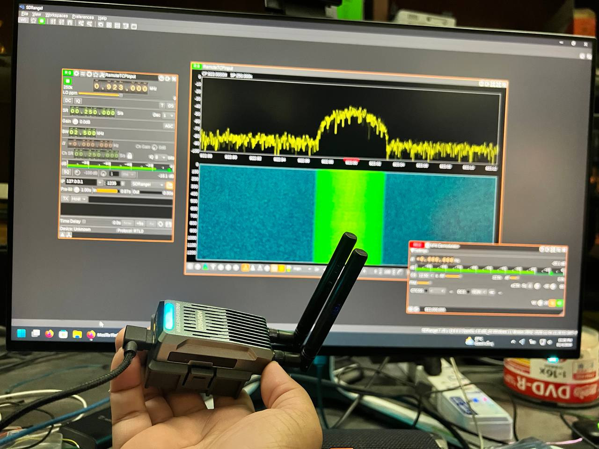

# Nomad-SDR

**Two Semtech LR1121 radios. One RadioMaster Nomad. A pocket wideband receiver that talks to SDRangel and SDR++.**



Firmware on the Nomad's main ESP32 turns the stock dual-LR1121 Gemini board into an I/Q source. Tune **150-2500 MHz**, watch the waterfall, and keep ExpressLRS a restore away.

## Live in one command

USB native (CP210x on the **main** MCU, COM3 on Windows):

```powershell
python -m pip install -r host/requirements-live.txt
python host/nomad_rtl_tcp.py --serial COM3 --radio 0 --port 1234
```

Or double-click `Start-Nomad-USB.cmd`. In SDRangel pick **Remote TCP Input** (SDR++: **RTL-TCP**) at `127.0.0.1:1234` and **250 kHz**.

Wi-Fi AP is `Nomad-SDR` / `nomadsdr1121` at `192.168.4.1`. STA credentials can be written over USB:

```powershell
python host/bridge.py --port COM3 --radio 0 wifi sta "SSID" "PASSWORD"
python host/nomad_rtl_tcp.py --host 192.168.4.1 --radio 0 --port 1234
```

## What you get

| | |
| --- | --- |
| Radios | Dual LR1121, ExpressLRS Nomad pin map, stock transceiver 1.3 |
| Live path | LIQ8 / LID8 to local rtl_tcp for SDRangel and SDR++ |
| USB native | 921600 baud LID8 I/Q on the main UART, one radio at a time |
| Wi-Fi | TCP 1121 / 1122, UART `wifi sta` stored in NVS |
| Tune | 150-2500 MHz synthesizer; matching is best on Nomad's 900 / 2.4 GHz antennas |
| Status | Full-brightness RGB: blue ready, green working, yellow buffered, red error |
| Thermal | Fan on at 50 °C die temperature, off at 42 °C |
| Control API | Local JSON `/api/v1` for RX, sweep, packet, CAD, gain, diagnostics, dual jobs |

## Frequency

Both radios tune **150-2500 MHz**. That is the LR1121 synthesizer span, not a promise of even sensitivity.

| Band | Support |
| --- | --- |
| 150-960 MHz | Specified RX. Nomad matching and antennas are strongest near 900 MHz (915 MHz is the usual first tune). |
| 1900-2200 MHz | Specified RX. |
| 2400-2500 MHz | Specified RX. Nomad 2.4 GHz antennas (2440 MHz is the usual first tune). |
| Gaps in 960-1900 and 2200-2400 MHz | Synthesizer will go there (1090, 1550, 2300 MHz were tried). Treat those as experiments. |
| Below 150 MHz | Out of range. FM broadcast 88-108 MHz is not supported. |
| Above 2500 MHz | Out of range. |

Native I/Q is 62.5 kS/s (USB LID8 31.25 kS/s). The 250 kHz rate in SDRangel is interpolated on the PC.

Guides: [USB native](docs/usb-native.md) · [live SDR](docs/live-sdr.md) · [control API](docs/control-api.md) · [Nomad port](docs/nomad.md) · [LIQ8](docs/LIQ8.md)

## Control API

Firmware **0.11.0** adds UART `capabilities` / `stream status` and a local JSON API for both LR1121 chips. Close any USB I/Q proxy first, then double-click `Start-Nomad-API.cmd` or run:

```powershell
python host/nomad_api.py --serial COM3
```

Base URL is `http://127.0.0.1:8094/api/v1`. JSON replies look like `{ "ok": true, "result": ... }`. The server holds COM3; stop it before `nomad_rtl_tcp.py`. Dual mode here shares the UART with a lock. It does not stream two I/Q radios at once.

```powershell
$nomadApi = 'http://127.0.0.1:8094/api/v1'
Invoke-RestMethod "$nomadApi/capabilities"
```

`{r}` is `0` or `1`. POST bodies are JSON objects; start/stop routes take `{}`.

| Method | Path under `/api/v1` | Role |
| --- | --- | --- |
| GET | `/capabilities` | Chip UID/version, modems, bandwidths, transport limits |
| GET | `/radios/{r}/status` | Controller profile, gain, and job |
| GET | `/radios/{r}/stream/status` | Native I/Q counters, queue, throughput, loss |
| POST | `/radios/{r}/rx/configure` | LoRa/GFSK setup, then standby |
| POST | `/radios/{r}/rx/start` | Continuous packet RX |
| POST | `/radios/{r}/rx/stop` | Cancel and standby |
| POST | `/radios/{r}/sweep/start` | Background RSSI scan |
| GET | `/radios/{r}/sweep/status` | Sweep progress and bins |
| POST | `/radios/{r}/sweep/stop` | Cancel sweep |
| POST | `/radios/{r}/packet/configure` | Packet profile |
| POST | `/radios/{r}/packet/start` | Background packet monitor |
| GET | `/radios/{r}/packet/status` | Payload, CRC, RSSI/SNR |
| POST | `/radios/{r}/packet/stop` | Cancel packet monitor |
| POST | `/radios/{r}/cad` | One-shot LoRa CAD (RX only) |
| GET/POST | `/radios/{r}/gain` | AGC/manual step, RxBoosted, LF0 topology |
| GET | `/radios/{r}/diagnostics` | LR1121 die temperature and supply |
| POST | `/dual/configure` | Store a two-radio sweep/packet plan |
| POST | `/dual/start` | Start the stored plan |
| GET | `/dual/status` | Both radios |
| POST | `/dual/stop` | Stop both radios |
| GET | `/jobs/{id}` | Job results still in memory |
| GET | `/jobs/{id}.csv` | Same results as CSV |

Examples, field limits, and error codes are in [control API](docs/control-api.md). UART telemetry: `python host/bridge.py --port COM3 --radio 0 capabilities` and `stream-status`.

## Build and flash

```powershell
python -m pip install platformio -r host/requirements.txt -r host/requirements-live.txt
python tools/test_nomad.py
python tools/build_nomad.py
```

Flash the merged image at offset `0x0` on the **main** ESP32-PICO-D4 (CP210x). Leave the backpack USB alone.

```powershell
python -m platformio pkg exec -p tool-esptoolpy -- esptool.py --chip esp32 --port COM3 write_flash 0x0 dist/nomad/nomad-sdr-merged.bin
```

Run that from the `nomad/` directory, or pass the absolute path to `nomad-sdr-merged.bin`.

Restore ExpressLRS with `python lr1121/install.py restore-elrs` plus a full-flash backup from `build/backups/`.

## Honest limits

[Experimental ARC packed acquisition](docs/packed-stream.md) is opt-in on the
verified radio 1 extension (`--packed-verification`). USB passed two 60-second
tests with retunes; native 125 kS/s was tested only with a short bounded capture.
Normal acquisition remains the default.

The control API is receive-only. Dual jobs share one UART; they are not dual
USB I/Q. Packet/CAD RF correctness still needs a reference transmitter.
Continuous Wi-Fi I/Q at 2.4 GHz and dual-radio I/Q still need validation.
Sensitivity outside Nomad's matched bands is unproven. The Pico LIP2/LIP3
250/500 kS/s path, TX, and native SDR++ module stay on the upstream RP2040 tree.

## Layout

- `nomad/` - ESP32 firmware (PlatformIO, MIT)
- `host/` - UART/TCP bridge, recorder, rtl_tcp adapter, JSON control API (`nomad_api.py`)
- `pico/` - original RP2040 firmware from [lr1121-sdr](https://github.com/naorunaoru/lr1121-sdr)
- `sdrpp/` - GPL-3.0 SDR++ source module for the Pico
- `docs/` - hardware notes, live setup, measurements

## Contributor

[hereismeaw](https://github.com/hereismeaw)

## Licensing

This tree started from [naorunaoru/lr1121-sdr](https://github.com/naorunaoru/lr1121-sdr). Pin map from [ExpressLRS Nomad](https://github.com/ExpressLRS/targets). LR1121 research lineage includes [radioegor146/lr-semtech-research](https://github.com/radioegor146/lr-semtech-research).

Independent firmware, host tools and docs: [MIT](LICENSE).
`sdrpp/` and Nomad receiver helpers derived from it: [GPLv3](sdrpp/LICENSE).
See [license scope](docs/licensing.md) and [third-party notices](THIRD_PARTY_NOTICES.md).
Semtech LR1121 images keep their vendor license. Do not commit `nomad/src/wifi.local.h`.
